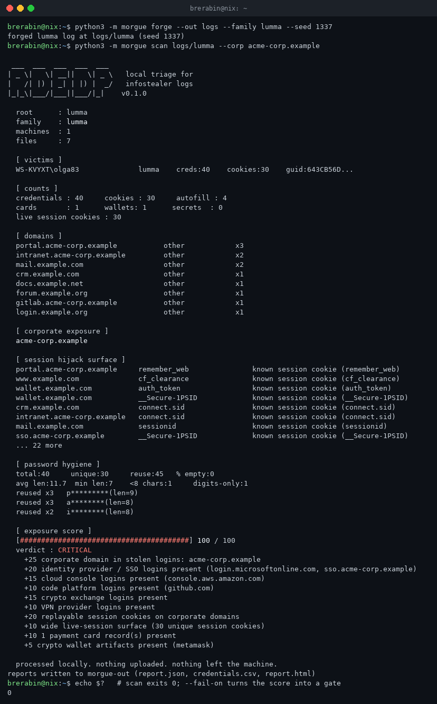
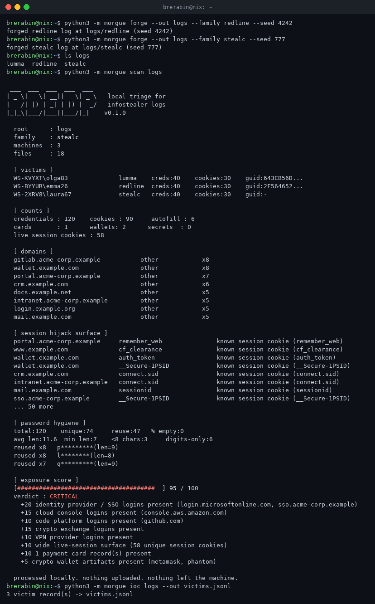
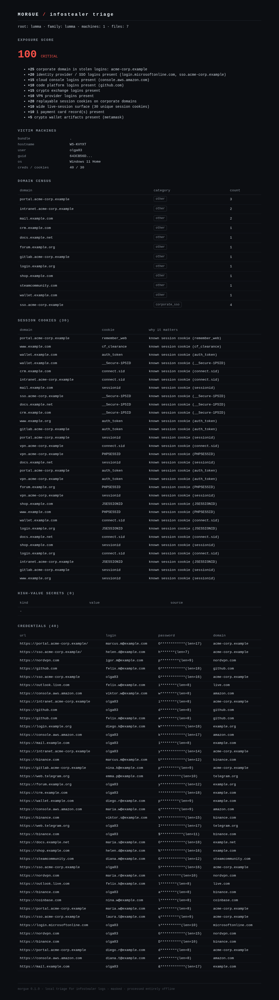

# morgue

> local triage for infostealer logs. nothing leaves the machine.

stealer logs are bulk commodities now. lumma survived two takedowns and hit
hundreds of thousands of devices in 2026. credential abuse is the #1 initial
access vector. every IR consultant ends up holding a folder of stolen logins
from a client and faces the same question: how do I triage this without
uploading my client's compromised credentials to somebody else's web panel?

you don't upload. you run morgue. python stdlib, one file, offline.



## what it does

- **family fingerprinting** - recognizes redline, lumma, stealc and
  rhadamanthys layout markers; anything else falls through to a generic
  tabular parser that still extracts credentials. unknown beats wrong.
- **full artifact sweep** - credentials, cookies, autofill, payment cards,
  wallet artifacts, telegram/tdata, screenshots dirs. machine identification
  from info blocks (text and json shapes).
- **session hijack surface** - flags cookies that are live, replayable
  sessions: `auth_token`, `__Secure-1PSID`, `.ASPXAUTH`, `PHPSESSID`,
  `cf_clearance`, microsoft ESTS cookies and more.
- **high-value secrets** - finds API tokens pasted into stolen data:
  `github_pat_`, `ghp_`, `sk_live_`, `AKIA`, `AIza`, `xox*`.
- **enterprise exposure score** - 0-100 with a reason trail. every point is
  defensible in a client report.
- **password hygiene** - reuse, empty, short, digits-only, all masked.
- **forge** - generates deterministic synthetic logs (lumma / redline /
  stealc) for training, demos and regression tests. no real data involved,
  ever.

## quickstart

```bash
# zero-install: single file zipapp, stdlib only
python3 morgue.pyz scan <log-dir> --corp yourclient.com

# or from source
python3 -m morgue scan <log-dir> --corp yourclient.com

# generate synthetic logs to learn the tool (safe, fake data)
python3 morgue.pyz forge --out logs --family lumma --seed 1337
python3 morgue.pyz scan logs/lumma
```

outputs land in `morgue-out/`: `report.json`, `credentials.csv`,
`report.html` (self-contained, zero external assets - safe on an air-gapped
workstation), plus `iocs.jsonl` via the `ioc` command.



## the exposure score

| signal | points |
|---|---|
| corporate domain in stolen logins | +25 per domain (cap 50) |
| replayable session cookies on corp/idp domains | +20 |
| identity provider / SSO logins | +20 |
| cloud console logins | +15 |
| crypto exchange logins | +15 |
| high-value API tokens | +15 |
| dev platform logins | +10 |
| vpn provider logins | +10 |
| banking / fintech logins | +10 |
| wide live-session surface (10+ cookies) | +10 |
| payment cards present | +10 |
| wallet artifacts present | +5 |

bands: `clean` 0 - `low` 1 - `medium` 20 - `high` 40 - `critical` 70.
automate it: `scan --fail-on high` exits 10 when the band is reached.

## masking policy

secrets are masked everywhere by default - passwords, cookie values, card
PANs, machine GUIDs, IPs, tokens. screenshots stay shareable. reports stay
forwardable. `--reveal` writes plaintext, locally, when you actually need
it. the ioc feed never carries secrets at all.

## honesty section

stealer panels rename folders between builds. morgue's detection is
fingerprint-based (file names, directory shapes, info-block keys), not a
magic oracle. when nothing matches, the generic tabular parser extracts
what it can and the report says so in warnings. line shapes covered:
3-col and 4+col credential rows, netscape 6/7-col plus 3/4/5-col cookie
variants, name/value autofill, pan/expiry card rows, `key: value` and flat
json machine info.

## forge

training classes, incident-response drills, CI fixtures: `forge --family
lumma --seed 42` writes a realistic-shaped but entirely fake log. reserved
domains only (`.example`, RFC 5737 hosts), generated credentials, random
cookie values. same seed plus same parameters produces byte-identical
trees - asserted in the test suite.



## verify it yourself

```bash
python3 -m unittest discover -s tests   # 80 tests
bash test/e2e_local.sh                  # forge -> scan -> artifacts -> exit codes
```

## collection

`hellhound` - canary tripwires against ransomware.
`gravedigger` - first-hour forensic triage for unix hosts.
`coroner` - client-side ransom-note identification.
`morgue` - what the logs are worth before the attackers monetize them.

MIT. no telemetry. no phoning home. the name of the tool is the procedure.
